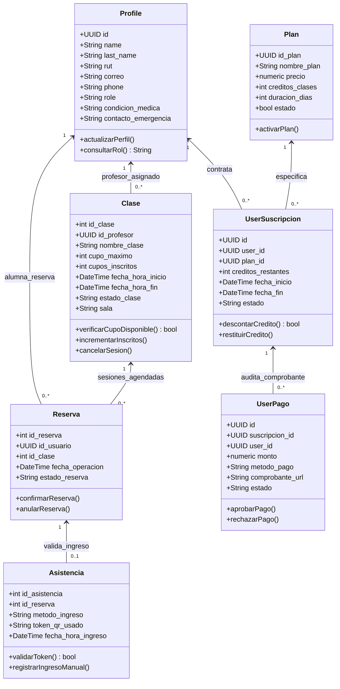
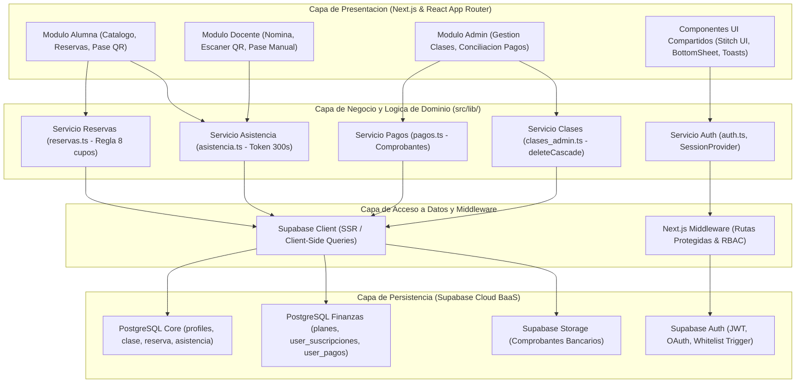
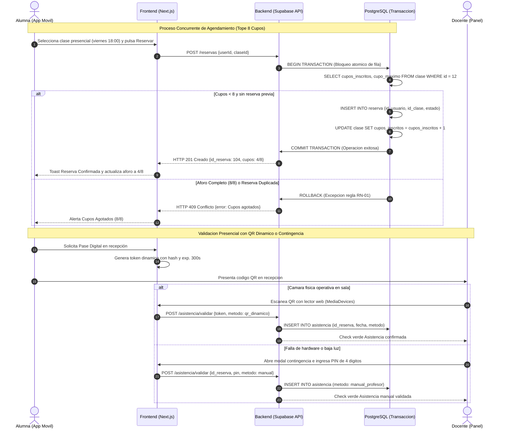
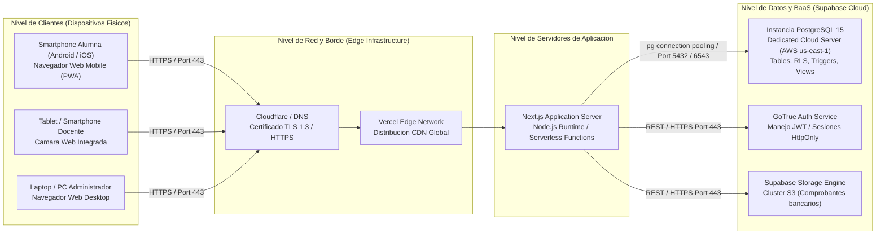
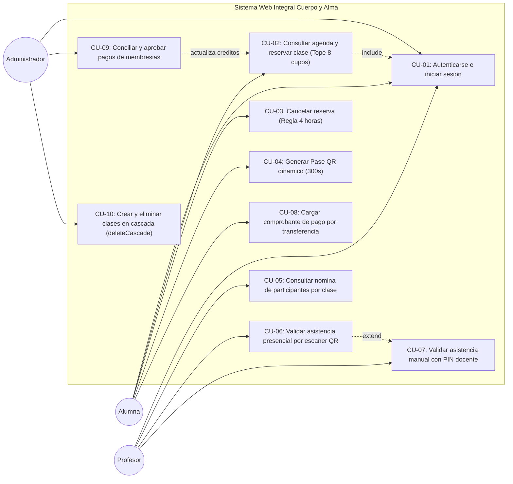

# Modelo Arquitectónico 4+1 de Kruchten · Sistema "Cuerpo y Alma"
**Asignatura:** Proyecto Capstone (PTY4614) · Duoc UC  
**Equipo:** José Rivera, Benjamín García, Manuel Campos  
**Docente Guía:** Reginaldo Salinas  

Este documento reúne las 5 vistas completas del **Modelo 4+1 de Kruchten** para la plataforma web de la academia de Pole Dance **"Cuerpo y Alma"**. Cada vista incluye su definición conceptual, el diagrama formal en código Mermaid (listo para copiar y pegar en [Mermaid Live Editor](https://mermaid.live/), [Notion](https://notion.so) o [GitHub](https://github.com)) y su justificación técnica en el proyecto.

---

## Índice de Vistas

1. [Vista Lógica (Logical View)](#1-vista-lógica-logical-view)
2. [Vista de Desarrollo o Implementación (Development View)](#2-vista-de-desarrollo-o-implementación-development-view)
3. [Vista de Procesos (Process View)](#3-vista-de-procesos-process-view)
4. [Vista Física o de Despliegue (Physical View)](#4-vista-física-o-de-despliegue-physical-view)
5. [Escenarios / Casos de Uso (El "+1")](#5-escenarios-casos-de-uso-el-1)

---

## 1. Vista Lógica (Logical View)

### Propósito
Representa la estructura estática interna, las entidades del dominio, sus atributos, métodos y cardinalidades. Modela cómo el sistema da soporte a las reglas del negocio: perfiles de usuario (RBAC), control estricto de 8 cupos por clase, desacoplamiento financiero de suscripciones y transacciones de pago, y registro de asistencias presenciales.

### Código Mermaid (`classDiagram`)

---

## 2. Vista de Desarrollo o Implementación (Development View)

### Propósito
Muestra la organización del código fuente en módulos, paquetes y capas dentro del entorno de desarrollo de Next.js y Supabase. Ilustra la separación en capas de presentación (Client Components Stitch), servicios de negocio desacoplados (`lib/`), acceso a datos y políticas de seguridad RLS en PostgreSQL.

### Código Mermaid (`flowchart TD`)

---

## 3. Vista de Procesos (Process View)

### Propósito
Describe la dinámica de ejecución concurrente, la sincronización entre actores y componentes, y la consistencia transaccional. Modela el agendamiento con bloqueo atómico para garantizar que nunca se supere el aforo de 8 barras, la generación del Pase QR seguro y la verificación presencial (con su respectiva contingencia manual).

### Código Mermaid (`sequenceDiagram`)

---

## 4. Vista Física o de Despliegue (Physical View)

### Propósito
Mapea los componentes de software en los nodos de hardware e infraestructura cloud real. Detalla la topología de red distribuida, protocolos de comunicación seguros (HTTPS/TLS 1.3), la red de distribución en el borde (Vercel Edge Network) y los servicios de base de datos dedicados en Supabase Cloud (AWS).

### Código Mermaid (`flowchart LR`)

---

## 5. Escenarios / Casos de Uso (El "+1")

### Propósito
Constituye el núcleo del modelo 4+1, validando y unificando las cuatro vistas anteriores a través de los casos de uso más representativos del negocio. Conecta a los tres actores clave (Alumna, Docente, Administrador) con los flujos críticos de la academia "Cuerpo y Alma".

### Código Mermaid (`flowchart LR`)

---

## Instrucciones para Renderizar en una Página Externa

1. **En [Mermaid Live Editor](https://mermaid.live/):**
   * Abre la página en tu navegador.
   * Selecciona el código de cualquiera de las 5 vistas anteriores y pégalo en el panel izquierdo.
   * Podrás ver el diagrama renderizado en tiempo real y exportarlo en formato **PNG**, **SVG** o enlace directo.

2. **En [PlantText / PlantUML](https://www.planttext.com/) o [Draw.io](https://app.diagrams.net/):**
   * En draw.io: Ve a `Organizar` > `Insertar` > `Avanzado` > `Mermaid`, pega el código y presiona `Insertar`.
